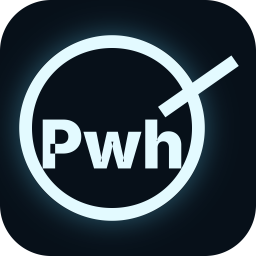

<h1 align="center">Pwh</h1>

<strong>모두를 위한 무료 한글 문서 편집기</strong> 한글처럼 익숙하게, 오픈소스로 자유롭게.

  <a href="https://apps.microsoft.com/detail/9NXGD60MHMT2">Windows 설치</a> ·
  <a href="https://tools.stoom.win/pwh/">제품 소개</a> ·
  <a href="https://github.com/wansucong-stoom/stoom-pwh/releases/latest">GitHub 릴리스</a> ·
  <a href="docs/USER-GUIDE.md">사용 안내</a> ·
  <a href="docs/README.md">문서 모음</a>

Pwh는 **무료·오픈소스 HWP/HWPX 문서 편집기**입니다. 익숙한 메뉴와 한글 호환 단축키로 글·표·그림을 편집하고, 작업한 문서를 **HWPX**로 저장합니다. 필요할 때 AI를 연결해 문서 수정을 요청할 수 있습니다.

## Pwh가 지향하는 세 가지

| **가장 한글같은 한글** | **가장 빠른 한글** | **가장 정확한 한글** |
| --- | --- | --- |
| 익숙한 메뉴와 단축키, 글·표·그림을 다루는 편집 경험을 이어갑니다. | 바뀐 부분을 중심으로 계산하고 반복 조회·전송·저장 비용을 줄입니다. | 표·그림·문단의 배치 기준을 맞추고 한글 출력과 저장·실행 취소 결과를 검증합니다. |
| [메뉴와 한글 호환 단축키](docs/USER-GUIDE.md) | **[지금까지의 속도 개선 이력](docs/PERFORMANCE-HISTORY.md)** | [조판 비교 결과와 검증 범위](docs/LAYOUT-FIDELITY.md) |

세 가지는 Pwh가 계속 발전시켜 갈 목표입니다. 상세 페이지에는 실제 지원 범위, 측정 조건, 남은 차이를 함께 공개합니다.

## 설치와 업데이트

| 환경 | 받는 곳 | 업데이트 |
| --- | --- | --- |
| **Pwh Desktop · Windows x64** | **[Microsoft Store](https://apps.microsoft.com/detail/9NXGD60MHMT2)** | Store에서 업데이트. 앱 상단에서도 새 Store 버전을 확인 |
| **Pwh Desktop · Linux x64 시험판** | [GitHub 릴리스](https://github.com/wansucong-stoom/stoom-pwh/releases/latest) · [설치 안내](docs/LINUX.md) | 같은 정식 릴리스의 Linux 패키지를 확인하고 앱에서 업데이트 |
| **Pwh 플러그인 · Codex 데스크톱** | [GitHub 릴리스의 플러그인 ZIP](https://github.com/wansucong-stoom/stoom-pwh/releases/latest) | 최신 플러그인으로 갱신 |

최근 정식 배포 기준은 **Pwh 0.6.66 · Desktop 0.1.47 · 공통 코어 r32**입니다. GitHub 배포와 Store 심사·게시 시점은 다르며, Store 설치판은 게시된 버전으로 업데이트됩니다. 이전 MSI 사용자는 [Store 이전 안내](docs/PWH-DESKTOP.md#설치와-사용)를 참고하세요.

기존 첨부 문서 열기와 빈 조판기 열기를 구분합니다. 기존 HWPX는 새 문서나 출력 폴더를 만들지 않고 읽기 전용으로 열기를 준비하며, 파일 준비와 실제 우측 편집기 로드를 구별합니다. 이전 버전의 MCP 연결 복구도 유지합니다. [지원·검증 범위](docs/verification/PLUGIN-FILE-OPEN.md)

[표의 상하좌우 자동 채우기](docs/AUTO-FILL.md), 대화상자 키보드 이동과 메뉴·제품 정보 정렬 보완이 포함됩니다. 설치판 반영 여부는 [변경 이력](docs/CHANGELOG.md)을 확인하세요.

**도형·연결선·글상자 그리기**와 **화면 폭·배율에 맞춘 자동 쪽 배치**를 공통 편집기와 Desktop에 제공합니다. [지원 및 검증 범위](docs/verification/DRAWING-AND-PAGE-ARRANGEMENT.md)

공통 조판 코어에서는 **저장된 쪽 경계와 그림·표의 공간 예약**을 함께 보완합니다. 누락된 글줄 정보를 보충할 때 유효한 쪽 시작점을 유지하고, 다음 쪽에 배치할 그림의 높이를 앞쪽 본문에 중복 부과하지 않습니다. [적용 조건과 검증 범위](docs/verification/STORED-PAGE-FRAMES.md)

**운영 사이트:** [STOOM Tools](https://tools.stoom.win/) · [Pwh 제품 소개](https://tools.stoom.win/pwh/) · [STOOM](https://stoom.win/)

## 주요 기능

| 기능 | 할 수 있는 일 |
| --- | --- |
| **익숙한 편집 화면** | 편집·보기·입력·서식·쪽·표·도구별 그래픽 메뉴, 스타일 목록, 모양 복사와 한글 호환 단축키 |
| **글과 문단** | 글자 모양, 정렬, 문단 간격·여백, 글머리표, 문자표, 찾기와 찾아 바꾸기 |
| **표와 중첩 표** | 셀 크기 조절, 너비·높이 맞추기, 행·열 편집, 병합·분할, 테두리·배경, 셀 복사·붙여넣기 |
| **그림과 개체** | 그림 이동·크기 조절·속성 편집, 그림 교체, 글자처럼 취급한 표 앞뒤 커서와 선택 |
| **용지와 출력** | 용지·여백 설정, 인쇄 미리보기, 쪽 범위 인쇄, 쪽을 그림으로 저장 |
| **문서 작업 공간** | 최근 문서, 여러 문서 탭, 문서별 AI 대화와 선택 영역 수정 요청 |
| **큰 파일** | 파일 크기와 연결 환경에 맞춘 분할 전송·저장 |

1. 새 문서를 만들거나 HWP·HWPX 파일을 엽니다.
2. 글·표·그림을 직접 편집합니다. AI가 필요하면 연결한 뒤 **AI 수정 요청**을 사용합니다.
3. 결과를 확인하고 HWPX로 저장합니다. HWP 원본은 보존하고 별도 작업본을 만듭니다.

문서 편집 기능은 무료입니다. 선택적으로 연결하는 AI 서비스에는 해당 서비스의 계정·이용 조건·요금이 적용될 수 있습니다. [Desktop 사용법](docs/PWH-DESKTOP.md) · [플러그인 설치](docs/USER-GUIDE.md#codex-plugin)

## 한글 호환 단축키

| 작업 | 단축키 |
| --- | --- |
| 글자 모양 / 문단 모양 | `Alt+L` / `Alt+T` |
| 문자표 / 편집 용지 | `Ctrl+F10` / `F7` |
| 문단·조판 부호 / 투명 선 | `Ctrl+G,T` · `Ctrl+G,C` / `Ctrl+G,B` |
| 쪽 맞춤 / 폭 맞춤 / 100% | `Ctrl+G,P` / `Ctrl+G,W` / `Ctrl+G,Q` |
| 셀 블록 선택 / 너비·높이 맞추기 | `F5` / 셀 블록에서 `W`·`H` |
| 되돌리기 / 다시 실행 | `Ctrl+Z` / `Ctrl+Shift+Z` |
| 인쇄 / 문서 탭 전환 | `Alt+P` / Desktop에서 `Ctrl+Tab` |

셀 안 글자 커서에서는 `Ctrl+Tab`으로 탭 문자를 넣습니다. [전체 단축키와 편집 상태별 동작](docs/USER-GUIDE.md#한글-호환-단축키)

## 편집 품질과 지원 범위

표의 쪽 나눔, 중첩 표와 그림 배치, 커서·선택이 같은 문서 구조를 따르도록 공통 편집기를 보완합니다. 변경된 셀과 상위 표의 계산 결과를 재사용하고, 그림 이동 중 불필요한 전체 문서 재생성을 줄입니다. 그림 이동의 실행 취소는 표 높이와 글줄 배치도 함께 복원합니다.

줄 간격만 바꾸는 동안에는 준비된 글자 폭 측정 목록을 재사용합니다. 본문·일반 표·중첩 표의 단축키와 실행 취소를 같은 기준으로 처리하며 Windows·Linux에 함께 적용합니다. [검증과 측정 조건](docs/verification/PARAGRAPH-SPACING-PERFORMANCE.md)

초기 문서 로딩·글꼴 전송부터 큰 표 선택, 중첩 셀 입력, 커서 조회, 큰 문서 전송, 그림 드래그와 반복 저장까지의 개선은 **[속도 개선 이력](docs/PERFORMANCE-HISTORY.md)**에 모았습니다. 적용 버전·변경 계층·전후 측정과 남는 비용을 구분합니다.

공통 코어와 편집기는 그림을 위로 옮길 때 셀 높이 보존, 빈 표 앵커의 중복 높이 계산과 잘못 추정한 외곽선, 반복 그림 압축 해제·글꼴 전송·복구 내보내기를 보완합니다. HWPX 저장에서는 내용이 같은 내장 자원의 압축 결과도 재사용합니다. [검증 범위와 배포 상태](docs/verification/CELL-PICTURE-RESOURCE-REUSE.md)

공통 표 크기 조절은 파일에 저장된 최소 높이 대신 실제 행 배치를 기준으로 드래그·단축키·높이 맞추기를 계산합니다. 일반·중첩·병합 표와 쪽 분할 표가 같은 기준을 사용하며, 편집 전의 문서 배치는 보존합니다. [적용 상태와 검증 범위](docs/verification/TABLE-RESIZE-GRID.md)

Pwh와 Desktop은 같은 공통 편집기와 **rhwp 기반 WASM 코어**를 사용합니다. 지원 범위와 검증 조건은 아래 문서에서 확인할 수 있습니다.

자동 채우기와 대화상자 개선은 공통 편집기의 명령·입력 처리에 적용합니다. 일반 표와 중첩 표가 같은 셀 경로와 실행 취소 체계를 사용하며, 같은 r32 조판 코어를 사용합니다.

98번 코어 패치는 기본 도형·글상자·곡선의 생성과 셀 경로 삽입, 연결선의 화살표 속성 보존을 담당합니다. 자동 쪽 배치는 문서의 조판을 바꾸지 않는 화면 표시 기능이며, rhwp Studio의 기존 다중 쪽 배치에 기본값·설정 이전을 연결합니다.

| 찾는 내용 | 안내 |
| --- | --- |
| **사용과 지원 범위** | [사용 안내](docs/USER-GUIDE.md) · [표 안의 명령](docs/TABLE-COMMANDS.md) · [기능 범위와 제한](docs/PWH-COMPATIBILITY-LIMITS.md) |
| **검증 결과** | [속도 개선 이력](docs/PERFORMANCE-HISTORY.md) · [현재 편집 성능](docs/EDITOR-PERFORMANCE.md) · [조판 비교 요약](docs/LAYOUT-FIDELITY.md) · [그림 이동·실행 취소](docs/verification/PICTURE-MOTION.md) |
| **개발과 기여** | [문서 모음](docs/README.md) · [아키텍처](docs/ARCHITECTURE.md) · [rhwp 원본 대비 변경](docs/RHWP-DIFFERENCES.md) · [기여 안내](CONTRIBUTING.md) · [변경 이력](docs/CHANGELOG.md) |

## 데이터와 오픈소스

문서 편집과 저장은 로컬에서 처리합니다. AI 요청에 포함한 본문과 문맥은 연결한 AI 제공자가 처리합니다. [개인정보 처리방침](docs/PRIVACY.md)에서 로컬 작업본·복구본과 AI 전송 범위를 확인하세요.

Pwh는 STOOM이 운영하는 독립 프로젝트이며, [rhwp](https://github.com/edwardkim/rhwp)의 문서 코어와 Studio를 바탕으로 공통 편집기·Desktop·AI 연결을 개발합니다.

[MIT 라이선스](LICENSE) · [외부 구성 요소 고지](THIRD_PARTY_NOTICES.md) · [보안 문제 신고](SECURITY.md)
