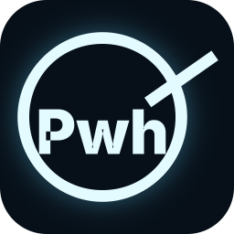

  

<h1 align="center">Pwh</h1>

<strong>한글에 익숙한 그대로, 오픈소스로 더 자유롭게.</strong> 선택적으로 AI를 연결하는 오픈소스 한글 문서 편집기

  <a href="https://apps.microsoft.com/detail/9NXGD60MHMT2">Microsoft Store에서 설치</a> ·
  <a href="https://tools.stoom.win/pwh/">제품 소개</a> ·
  <a href="https://github.com/wansucong-stoom/stoom-pwh/releases/latest">최신 릴리스</a> ·
  <a href="docs/USER-GUIDE.md">사용 안내</a> ·
  <a href="docs/README.md">문서 모음</a>

HWP·HWPX 문서를 열고, 글과 표를 직접 편집하거나 선택한 부분의 수정을 AI에게 요청할 수 있습니다. 작업한 문서는 편집 가능한 **HWPX**로 저장합니다. HWP에서 시작하면 원본을 보존하고 HWPX 작업본을 만듭니다.

## 시작하기

| 환경 | 사용 방법 |
| --- | --- |
| **Pwh Desktop** · Windows x64 | **[Microsoft Store에서 설치](https://apps.microsoft.com/detail/9NXGD60MHMT2)**하고 Store에서 업데이트합니다. 앱에서 선택적으로 AI를 연결하며 별도 Codex 설치 없이도 기본 편집을 사용할 수 있습니다. [Desktop 설치와 사용](docs/PWH-DESKTOP.md#설치와-사용) |
| **Pwh 플러그인** · Codex 데스크톱 | Codex 대화와 나란히 한글 편집기를 엽니다. GitHub에서 소스와 플러그인 **ZIP**을 받을 수 있습니다. [Codex 플러그인 설치](docs/USER-GUIDE.md#codex-plugin) |

**최신 정식 릴리스**는 Pwh **0.6.52**, Desktop **0.1.33**, 공통 코어 **r25**입니다. 버전별 다운로드, 변경 이력, SHA-256과 검증 범위는 [GitHub 릴리스](https://github.com/wansucong-stoom/stoom-pwh/releases/tag/v0.6.52)에서 확인할 수 있습니다.

Desktop의 신규 설치·업데이트는 **Microsoft Store**로 통일합니다. 기존 MSI 배포 파일은 보존하지만 이후 MSI 업데이트는 배포하지 않습니다. GitHub 릴리스는 **플러그인 ZIP·소스·고정 코어·검증 자료**를 계속 제공합니다. 기존 MSI 사용자는 [Store 이전 안내](docs/PWH-DESKTOP.md#설치와-사용)를 참고하세요.

## 할 수 있는 일

| 작업 | 예시 |
| --- | --- |
| **작성과 수정** | 기존 양식으로 초안 작성, 선택한 문단 다듬기, 본문과 중첩 셀에서 특정 문구 수정 |
| **표와 그림 편집** | 셀 복사·붙여넣기, 표 서식 통일, 셀 테두리·배경 설정, 지원되는 그림 교체 |
| **용지와 인쇄** | 용지 그림에서 여백 위치 확인, 인쇄 미리보기 확대·축소, 쪽 범위 인쇄 및 그림 저장 |
| **Desktop 작업 공간** | 최근 문서, 여러 문서 탭과 문서별 AI 대화 |

1. 새 문서를 만들거나 HWP·HWPX 파일을 엽니다.
2. 글이나 셀을 선택한 뒤 **AI 수정 요청**을 누르거나 편집기에서 직접 고칩니다.
3. 결과를 확인한 뒤 **HWPX**로 저장합니다.

[요청 예시](docs/USER-GUIDE.md) · [기능 범위와 제한](docs/PWH-COMPATIBILITY-LIMITS.md)

## 표 편집과 반응 속도

- **안전한 잘라내기** — 복사와 클립보드 기록이 성공해야 원문을 삭제합니다. 지연 처리 중 문서·선택·포커스가 바뀌면 취소합니다. [rhwp 0.9.0에서 선택 반영한 오류 수정](docs/UPSTREAM-0.9-REVIEW.md)

- **서식 보존** — 문단 간격·배경·테두리 중 바꾼 속성만 적용합니다. 속성 창을 확인만 했을 때 원래 수치와 서식을 보존하고, 문단 위·아래 간격의 pt를 실제 배치에 맞춥니다. [공통 코어 보완](docs/RHWP-DIFFERENCES.md#format-property-preservation)

- **표 속성** — 중첩 표도 선택한 표의 속성을 엽니다. 표 바깥쪽 선택 범위를 넓히고, 테두리 더블클릭과 상단 개체 속성을 같은 경로에 연결합니다. 셀 크기 조절과 셀 안 단어 선택은 편집 상태에 따라 구분합니다. [적용 범위](docs/OBJECT-PROPERTIES.md)

- **표 편집** — 셀 폭을 바꾸면 새 줄 높이와 문단 간격을 다시 계산해 글줄이 겹치지 않게 합니다. 긴 중첩 표를 편집할 때 줄 단위 나눔이 허용되면 현재 쪽의 남은 본문 공간을 사용합니다.
- **편집 반응** — 셀 크기 변경에 필요한 행·열 정보를 문서 모델에서 읽고, 셀 선택 표시는 보이는 쪽만 갱신합니다. 같은 서식의 글자 폭 표도 재사용합니다. 큰 표에서 쪽을 다시 나누는 지연은 남아 있습니다.

## 한글 호환 단축키

| 작업 | 단축키 |
| --- | --- |
| 글자 모양 / 문단 모양 | `Alt+L` / `Alt+T` |
| 문자표 / 편집 용지 | `Ctrl+F10` / `F7` |
| 셀 블록 선택 / 너비·높이 맞추기 | `F5` / 셀 블록에서 `W`·`H` |
| 되돌리기 / 다시 실행 | `Ctrl+Z` / `Ctrl+Shift+Z` |
| 인쇄 / 문서 탭 전환 (Desktop) | `Alt+P` / `Ctrl+Tab` |

셀 안에 글자 커서가 있을 때는 `Ctrl+Tab`으로 탭 문자를 넣습니다. [편집 상태별 한글 호환 단축키](docs/USER-GUIDE.md#한글-호환-단축키)

## 조판 엔진과 검증

Pwh와 Pwh Desktop은 [rhwp](https://github.com/edwardkim/rhwp) 0.8.7 기반 공통 WASM 코어를 사용합니다. r25의 [코어 변경 기록](docs/RHWP-DIFFERENCES.md)에서 표 편집, 쪽 나눔, 글꼴 계산의 수정 범위를 확인할 수 있습니다.

r23 정식 빌드는 익명 시험 문서 3개의 150쪽과 그림 시험 문서 17쪽, 편집 사례 5건에서 검증용 빌드와 동일한 글자 좌표·SVG를 냈습니다. 아래 표는 앞선 공통 코어 개선에서 동일한 원본을 한컴 PDF와 비교한 결과입니다.

r24는 쪽을 넘겨 이어지는 셀에서 문단에 속한 자리차지 그림을 현재 조각의 문단 시작점에 배치합니다. 그림 앞 제목들의 높이를 셀 상단 정렬로 덮어쓰던 문제를 보완했습니다. [연속 셀 그림의 시작점](docs/RHWP-DIFFERENCES.md#continued-flow-picture-anchor)

r23 공통 코어는 여러 쪽에 걸친 셀에서 끝 그림의 높이와 다음 쪽의 시작 경계를 같은 분할 단위로 계산합니다. [그림 배치 수정과 검증 범위](docs/RHWP-DIFFERENCES.md#inline-picture-frame-trailing-spacing)

r23은 셀 크기 조절과 중첩 셀 입력에서 바뀐 셀 문단과 상위 표를 다시 계산하고, 같은 원본·폭·용지 조건의 셀 글줄과 중첩 표 높이를 재사용합니다. 뒤쪽 쪽은 경계와 배치 정보가 일치하면 조판 결과와 렌더 캐시를 유지합니다. 커서 좌표 조회와 화면 그리기도 원본 셀의 계산값을 공유합니다. [증분 계산과 검증 범위](docs/RHWP-DIFFERENCES.md#incremental-table-edit-measurements)

| 익명 시험 문서 | 출력 쪽 수 전후 | 일반 잉크 F1 전후 |
| --- | ---: | ---: |
| TEST 문서 A | 48 → 46쪽 | 60.4097% → **97.8304%** |
| TEST 문서 B | 65 → 65쪽 | 97.4459% → **99.2010%** |

두 시험 문서 **111쪽**을 한컴 기준 PDF와 비교했습니다. 같은 물리 쪽을 150dpi, 위치 오차 2픽셀 허용 조건에서 대조한 잉크 겹침 점수입니다. 문서 B의 전체 전후에는 인쇄용 기준 글꼴의 효과도 포함됩니다. [검증 결과와 한계](docs/LAYOUT-FIDELITY.md#test-document-update) · [공통 코어와 원본의 차이](docs/RHWP-DIFFERENCES.md)

## 문서 바로가기

| 찾는 내용 | 문서 |
| --- | --- |
| **설치와 사용** | [사용 안내](docs/USER-GUIDE.md) · [Desktop](docs/PWH-DESKTOP.md) · [설정과 글꼴](docs/CONFIGURATION.md) |
| **조판과 검증** | [PDF 비교 및 쪽별 판정](docs/RENDER-COMPARISON.md) · [검증 결과](docs/LAYOUT-FIDELITY.md) · [코어 패치](docs/engine-patches/README.md) |
| **개발과 기여** | [전체 문서 모음](docs/README.md) · [아키텍처](docs/ARCHITECTURE.md) · [기여 안내](CONTRIBUTING.md) · [변경 이력](docs/CHANGELOG.md) |

## 데이터와 라이선스

문서 편집과 저장은 로컬에서 처리합니다. AI 요청에 포함한 본문과 문맥은 연결한 AI 제공자가 해당 서비스의 정책에 따라 처리합니다. [개인정보 처리방침](docs/PRIVACY.md)에서 로컬 작업본·복구본, 계정 정보와 선택적 AI 전송 범위를 확인할 수 있습니다.

Pwh는 STOOM이 운영하는 독립 프로젝트입니다. [MIT 라이선스](LICENSE) · [외부 구성 요소 고지](THIRD_PARTY_NOTICES.md) · [보안 문제 신고](SECURITY.md)
