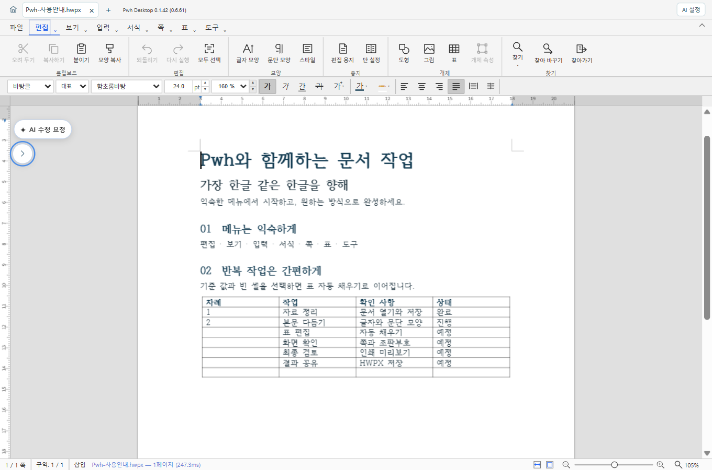
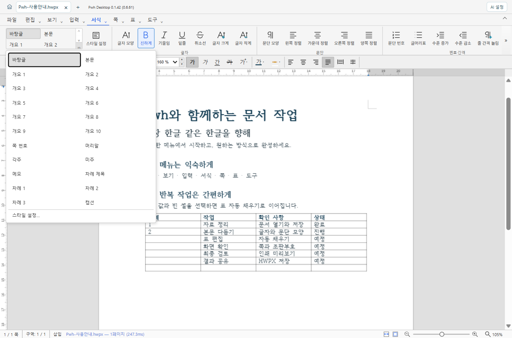
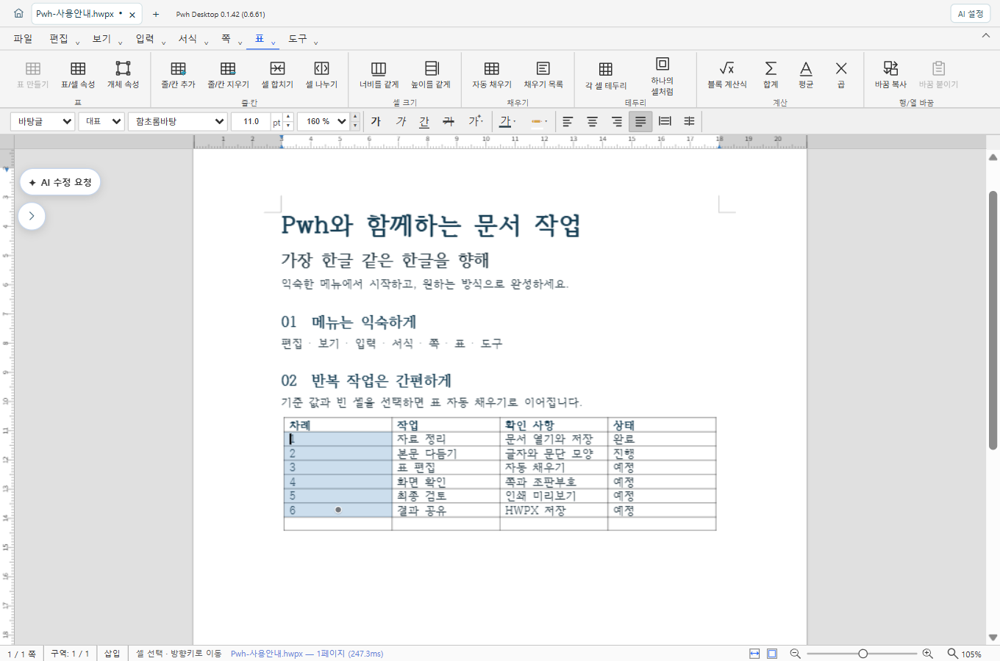

# Pwh 사용 안내

[프로젝트 소개와 다운로드](../README.md) · [문서 모음](README.md)

## 가장 한글 같은 한글을 향해

Pwh는 **한글을 쓰던 손에 익숙한 무료 오픈소스 한글 편집기**를 목표로 합니다. 메뉴의 위치와 작업별 도구 상자, 문서 스타일을 고르는 방식, 표의 셀 블록과 우클릭 메뉴, 모양 복사 대화상자까지 익숙한 흐름으로 연결했습니다. 아이콘과 화면 표현은 Pwh에 맞게 만들었으며, 지원하는 기능은 그래픽 버튼·목록 메뉴·단축키에서 같은 편집 명령으로 실행합니다.

**가장 한글 같은 한글 · 가장 빠른 한글 · 가장 정확한 한글**은 Pwh가 추구하는 세 방향입니다. 아래에서는 실제 제공하는 화면과 사용법을 안내합니다. 속도 개선의 적용 범위와 측정 결과는 [성능 개선 기록](PERFORMANCE-HISTORY.md), 문서 호환 범위는 [지원 기능과 제한](PWH-COMPATIBILITY-LIMITS.md)에서 확인할 수 있습니다.



*Pwh Desktop 0.1.42의 편집 화면. 공개 안내용 예제 문서이며, 메뉴 아래 도구 상자와 글꼴·크기·정렬 줄을 함께 사용할 수 있습니다.*

## Pwh Desktop

Windows x64에서는 **[Microsoft Store에서 Pwh Desktop을 설치](https://apps.microsoft.com/detail/9NXGD60MHMT2)**합니다. 업데이트도 Store에서 받습니다. 기본 문서 편집에는 AI 로그인이 필요하지 않습니다. AI를 사용하려면 **AI 설정 → ChatGPT로 계속**으로 계정을 연결하거나, 설치된 Codex 또는 준비한 로컬 AI 서버를 선택할 수 있습니다. 기존 MSI에서 Store로 이전하는 방법과 Windows 인쇄는 [Desktop 안내](PWH-DESKTOP.md#설치와-사용)에 정리했습니다.

GitHub는 아래 Codex 플러그인과 소스·코어 배포에 계속 사용합니다. 신규 MSI 업데이트는 배포하지 않습니다.

<a id="codex-plugin"></a>

## Codex 플러그인

저장소에서 설치하려면 Windows x64, Node.js 22.12 이상(22 계열) 또는 24 이상, Python 3.11 이상, Git, 로컬 플러그인과 MCP 실행을 지원하는 Codex가 필요합니다.

```powershell
git clone https://github.com/wansucong-stoom/stoom-pwh.git
cd stoom-pwh
node scripts/setup.mjs
codex plugin marketplace add .
codex plugin add pwh@pwh
```

새 Codex 대화에서 Pwh를 선택합니다. 설치 명령은 해시로 고정된 런타임을 준비합니다. [오프라인 설치와 런타임 갱신](engine-preservation.md)

## 문서 열기부터 저장까지

Codex에서 파일을 첨부하고 **“열어 줘”**라고 하면 그 문서를 엽니다. **“빈 조판기를 열어 줘”**, **“새 문서”**라고 요청하면 빈 문서를 만듭니다. 기존 파일을 열지 못했을 때 빈 문서로 대신하지 않으며, 파일 준비가 끝났어도 우측 편집기에 실제 로드됐는지 확인합니다.

1. 새 문서를 만들거나 HWP·HWPX 파일을 엽니다. Codex에서 “빈 한글 편집기를 열어 줘”라고 요청할 수도 있습니다.
2. 본문에 입력하고, 글이나 셀을 선택해 상단 도구 상자 또는 우클릭 메뉴에서 모양을 바꿉니다. 표와 그림은 **입력**, 문단과 스타일은 **서식**, 용지와 머리말은 **쪽**에서 찾습니다.
3. **보기**에서 조판부호와 화면 배율을 조절하고, 인쇄 미리보기에서 결과를 확인합니다. AI 수정은 필요할 때 선택해서 사용합니다.
4. Codex 편집기에서는 **새 수정본 저장**, Desktop에서는 **파일 → 저장** 또는 **다른 이름으로 저장**을 사용합니다.

AI 편집에서는 “표 안에서 ‘제출 전 확인’ 문구만 빨간색으로 바꿔 줘”처럼 요청할 수 있습니다. 본문·일반 표·중첩 표에서 원문을 찾은 뒤 지정한 글자 범위에 색상, 굵게, 기울임, 크기를 적용합니다. 같은 문구가 여러 곳에 있으면 표 제목이나 셀 주변 내용으로 위치를 지정할 수 있습니다. 한 요청에서 적용된 글자 모양은 실행 취소 한 번으로 되돌립니다.

<a id="contextual-ribbon"></a>

## 메뉴와 도구 상자

상단 **편집·보기·입력·서식·쪽·표·도구** 이름을 누르면 그 작업의 그래픽 도구가 표시됩니다. 글꼴·크기·정렬을 고르는 아래 서식 줄은 유지됩니다. 메뉴 이름 옆의 **⌄**는 기존 목록 메뉴를 엽니다. **파일**은 목록 메뉴로 열립니다.

| 하려는 작업 | 상단 메뉴와 주요 도구 |
| --- | --- |
| 복사하고 고치기 | **편집** — 오려 두기·복사·붙이기, 모양 복사, 실행 취소, 찾기·찾아 바꾸기·찾아가기 |
| 편집 화면 살펴보기 | **보기** — 문단 부호·조판 부호·투명 선, 격자, 도구 상자, 확대·쪽 맞춤·폭 맞춤 |
| 문서에 넣기 | **입력** — 도형·그림·표·글상자, 수식, 각주·미주, 책갈피·하이퍼링크·문자표 |
| 글과 문단 꾸미기 | **서식** — 문서 스타일, 글자·문단 모양, 정렬, 문단 번호·글머리표·수준·간격 |
| 쪽 구성하기 | **쪽** — 편집 용지, 쪽 테두리·배경, 머리말·꼬리말, 번호·감추기, 쪽·단·구역 나누기 |
| 표 다듬기 | **표** — 셀 속성·테두리·배경, 합치기·나누기, 너비·높이 같게, 자동 채우기, 계산 |
| 설정과 이력 확인 | **도구** — 문서 이력·비교, 환경 설정, 제품 정보 |

문서의 선택 상태와 지원 범위에 따라 사용할 수 있는 도구가 달라집니다. 예를 들어 **셀 나누기**는 셀을 선택한 뒤 실행합니다. 대화상자가 열리면 **Tab / Shift+Tab**으로 그 안의 입력란과 버튼을 이동하고 **Esc**로 닫습니다.

창이 좁아지면 메뉴를 한 줄로 유지하고 **»**에서 다른 메뉴를 선택합니다. Desktop 창은 최소 너비 360까지 줄일 수 있습니다. 도구 상자의 **« / »**는 앞뒤 도구 그룹으로 이동합니다. 상단 메뉴에 키보드 초점을 두면 좌우 방향키와 Home/End로 전환하고 **Alt+↓**로 목록을 엽니다. » 목록은 위아래 방향키로 이동하고 Enter로 선택하거나 Esc로 닫습니다.

표·셀 선택 등 현재 편집 상태가 필요한 버튼은 해당 상태에서 활성화됩니다. 등록되지 않았거나 아직 구현되지 않은 기능을 새 그래픽 버튼으로 표시하지 않습니다. 서식 메뉴의 스타일은 문서에 있는 실제 스타일을 적용합니다.

- **도구 상자 다시 펼치기:** 상단 메뉴 줄이나 도구 상자를 우클릭하고 **기본 도구 상자 / 서식 도구 상자**를 선택합니다. 두 상자가 모두 접혀도 메뉴 줄에서 열 수 있습니다.
- **스타일 전체 목록:** 서식의 스타일 옆 위·아래 화살표로 항목을 이동하고, 맨 아래 펼치기로 문서의 전체 스타일을 두 열로 봅니다. 하단 **스타일 설정…**에서 속성을 엽니다.
- **글머리표:** 서식 → 글머리표에서 줄 미리보기를 보고 고릅니다. 최근 항목·없음·확인용 기호를 제공하며 **글머리표 모양…**은 상세 설정을 엽니다.
- **찾기:** 본 버튼은 찾기를 실행하고 아래 화살표는 찾기 관련 목록을 엽니다.
- **모양 복사:** 원본에 커서를 두고 **Alt+C** 또는 **모양 복사**를 누릅니다. 글자 모양·문단 모양·둘 다 중 선택한 뒤 대상을 선택하고 다시 Alt+C 또는 모양 붙이기로 적용합니다. 일반 표 안에서는 셀 속성·테두리·배경을 따로 복사하고 **F5 셀 블록**에 적용할 수 있습니다. 셀 크기는 복사하지 않으며 중첩 표의 셀 모양과 스타일 복사는 아직 지원하지 않습니다.
- **감추기 부호 삭제:** 조판부호를 표시한 상태에서 본문의 `[감추기]` 앞에 커서를 놓고 **Delete**를 누릅니다. 부호만 삭제하며 실행 취소로 복원할 수 있습니다. 모든 제어부호에 대한 삭제 지원으로 확대 해석하지 마세요.

Desktop의 상단 **붙이기**는 현재 문서 입력 위치로 실제 붙여넣기 명령을 보냅니다. 비동기 확인 중 문서·선택·포커스가 달라지면 취소합니다. Ctrl+V는 기존 입력 경로를 사용합니다.



*처음 보이는 네 항목 외에도 문서에 들어 있는 스타일을 펼쳐 선택합니다. 목록의 내용은 여는 문서마다 달라집니다.*

## AI와 함께 편집하기

글이나 셀을 선택해 **AI 수정 요청**을 엽니다. 우클릭 메뉴에서도 요청할 수 있고 **Ctrl+Enter**로 보냅니다. 요청을 기다리는 동안 다른 영역을 편집할 수 있으며, 요청한 영역을 바꿨다면 충돌을 확인하고 다시 요청합니다. 결과를 확인한 뒤 저장합니다.

> 선택한 문단을 의미는 유지하면서 간결하게 다듬어 줘.
>
> 이 표의 디자인을 다른 표에도 적용해 줘.
>
> 용지를 A4 가로 방향으로 바꾸고 좌우 여백을 20mm로 설정해 줘.

## 표와 개체 편집

**도형 도구:** 입력 또는 편집의 **도형**을 열고 글상자·사각형·타원·직선·호·다각형·곡선·자유선을 고릅니다. 기본 도형은 영역을 드래그하고, 다각형·곡선은 꼭짓점을 클릭한 뒤 Enter 또는 더블클릭으로 마칩니다. Esc는 생성 전 상태로 취소합니다. Shift는 기본 도형의 비율이나 선의 방향을 맞춥니다.

연결선은 직선·꺾인선·곡선과 화살표 없음·단방향·양방향 조합을 고릅니다. 드래그하거나 시작점·끝점을 클릭하고, 본문 개체의 연결점 가까이에서 시작·끝내면 해당 개체에 연결합니다. 선택 후 **개체 속성 → 선**에서 색·굵기·선 종류·시작/끝 화살표와 크기를 바꿉니다. 글상자는 더블클릭해 입력하고, 일반 도형·선은 더블클릭으로 속성을 엽니다. 생성은 Ctrl+Z 한 번으로 취소할 수 있습니다. [현재 지원·검증 범위](verification/DRAWING-AND-PAGE-ARRANGEMENT.md)

**자동 쪽 배치:** 배율 설정에서 **자동**을 선택하면 화면 폭과 현재 배율에 들어가는 쪽 수를 한 줄에 표시합니다. 순서는 **1·2 / 3·4**처럼 왼쪽에서 오른쪽, 다음 줄로 이어집니다. 창을 좁히거나 확대하면 열 수가 줄어들고, 넓히거나 축소하면 늘어납니다. 단일 쪽 등 명시적으로 선택한 배치는 그대로 유지합니다. 이 기능은 문서의 쪽 나눔과 저장 치수를 바꾸지 않습니다.

**[표 자동 채우기](AUTO-FILL.md)**는 기준 값과 빈 셀을 함께 드래그한 뒤 `A` 또는 우클릭 메뉴로 실행합니다. 예를 들어 `1`, `2`가 든 셀부터 아래 빈 셀까지 선택하면 `3`, `4`처럼 이어집니다. 상하좌우 드래그 방향을 따르며 **선택 범위의 빈 셀만** 채웁니다. 기존 값과 선택 밖의 셀은 유지하고, **Ctrl+Z 한 번**으로 전체 채우기를 되돌릴 수 있습니다. **자동 채우기 내용…**에서는 기본 목록과 사용자 정의 목록을 선택합니다.



*연번 1·2를 기준으로 선택한 셀에 3~6을 채웠습니다. 선택 밖 맨 아래 빈 셀과 옆 열은 유지됩니다.*

| 동작 | 방법 |
| --- | --- |
| 표 만들기 | **Ctrl+N**을 누른 뒤 **T** |
| 셀 속성 | 셀 선택 후 **P** |
| 셀 테두리·배경 | 셀 선택 후 **L** 또는 우클릭 메뉴 |
| 셀 내용 지우기 | 셀 선택 후 **Delete**. 줄이나 칸 전체를 선택했다면 해당 줄이나 칸을 삭제할 수도 있습니다. |
| 그림·표 속성 | 개체를 선택하거나 표 안에 커서를 둔 뒤 **개체 속성** |

셀에 표를 붙일 때 **셀 안에 표로 넣기**와 **기존 셀에 붙이기**를 선택할 수 있습니다. 기존 셀에 붙일 때는 범위와 병합 구조가 맞아야 하며 대상 셀의 서식을 유지합니다. 한글에서 복사한 표가 일반 붙여넣기로 들어오지 않으면 Codex 편집기의 **한글 표·셀 가져오기**를 사용합니다. [복사 형식별 지원 범위](PWH-COMPATIBILITY-LIMITS.md#편집기-복사붙여넣기)

## 한글 호환 단축키

아래 표는 Pwh의 Windows 단축키입니다. 셀에 커서가 있을 때와 F5로 셀 블록을 선택했을 때 같은 키의 동작이 달라집니다.

| 편집 상태 | 키 | 동작 |
| --- | --- | --- |
| Desktop 파일 | **Alt+N / O / S / V / P** | 새 문서, 열기, 저장, 다른 이름으로 저장, 인쇄 |
| 본문 | **Ctrl+Y**, **Alt+Y**, **Ctrl+T** | 현재 글줄 지우기, 커서 뒤부터 글줄 끝까지 지우기, 뒤 단어 지우기 |
| 본문 | **Ctrl+Page Up / Down** | 문서 처음 / 끝으로 이동 |
| 글자 서식 | **Alt+Shift+C** | 굵게, 기울임, 밑줄, 첨자 등 글자 속성을 해제합니다. 가운데 정렬은 **Ctrl+Shift+C**입니다. |
| 보기 | **Shift+숫자패드 + / −** | 편집 화면 확대 / 축소 |
| 보기 겹글쇠 | **Ctrl+G,T / C / B** | 문단 부호 / 조판 부호 / 투명 선 전환 |
| 화면 배율 겹글쇠 | **Ctrl+G,P / W / Q** | 쪽 맞춤 / 폭 맞춤 / 100% |
| 삽입 겹글쇠 | **Ctrl+K,H / B**, **Ctrl+N,N / E / T** | 하이퍼링크 / 책갈피, 각주 / 미주 / 표 만들기 |
| 셀에 커서 | **Alt+방향키** | 이웃 셀로 이동 |
| 셀에 커서 또는 셀 블록 | **Shift+Esc** | 현재 표에서 나오기 |
| 최외곽 표 | **Ctrl+Backspace** | 현재 행 지우기. 본문에서는 앞 단어를 지웁니다. |
| F5 셀 블록 | **Alt+방향키** | 오른쪽 열 또는 아래 행과 치수를 나눠 조절합니다. 이웃 행·열이 있는 연속 선택 범위에 적용합니다. |
| F5 셀 블록 | **P / L / C / B / F** | 표·셀 속성, 각 셀 테두리, 각 셀 배경, 여러 셀 테두리, 여러 셀 배경 |
| 실행 취소와 다시 실행 | **Ctrl+Z / Ctrl+Shift+Z** | 편집을 되돌리거나 다시 실행 |

겹글쇠는 첫 조합을 누른 뒤 마지막 글쇠를 이어서 누릅니다. Pwh 0.6.59부터 대기 시간이 2.5초를 넘거나 문서·창의 입력 초점이 떠나면 취소합니다. Ctrl은 두 번째 글쇠까지 누르고 있어도 됩니다. Desktop의 **Alt+V는 다른 이름으로 저장**이며 투명 선에는 **Ctrl+G,B**를 사용합니다.

목록 메뉴는 문서 입력과 별도로 키를 처리합니다. 메뉴를 연 상태의 Esc는 목록만 닫고 기존 셀 블록을 유지합니다. Delete와 선택하지 않은 Enter는 뒤의 문서를 편집하지 않습니다. 위아래 방향키와 Home/End로 표시된 활성 항목을 고르고 Enter로 실행합니다. [실제 입력 시험과 배포 상태](verification/MENU-SHORTCUTS.md)

중첩 표의 행 구조 변경, 개별 셀만 크기를 바꾸는 **Shift+방향키**, 이전·다음 커서 위치 이동과 한글의 별도 전용 기능은 남아 있습니다. [한컴 한/글 공식 단축키 일람](https://help.hancom.com/hoffice130_assistant/ko-KR/Hwp/view/toolbar/shortcut%28table%29.htm)

## 인쇄와 버전 확인

Desktop에서는 **Alt+P** 또는 **파일 → 인쇄**로 쪽 범위, 프린터와 미리보기를 확인합니다. 별도 인쇄 미리보기에서도 확대·축소할 수 있습니다. [인쇄와 미리보기](PWH-DESKTOP.md#공통-편집-기능)

편집기 상단에서 Pwh 버전을 확인합니다. 업데이트 직후 이전 버전이 보이면 미저장 작업을 저장하고 앱을 다시 엽니다. Codex 플러그인은 새 대화에서 확인합니다.

Store 설치판은 시작할 때, 앱으로 돌아올 때, 실행 중 주기적으로 Store 업데이트를 확인합니다. 설치 가능한 버전이 확인되면 상단에 **새 업데이트가 있습니다.** 버튼이 나타납니다. 버튼으로 Store를 열어 업데이트합니다. GitHub 공개 시점과 Store 심사·게시 시점은 다를 수 있습니다.

문서 열기·저장의 고정 **64MiB 제한을 제거**했습니다. 파일 크기와 연결 환경에 따라 나눠 전송하며, 실제 편집 가능 크기와 반응 속도는 메모리·문서 구조에 따라 다릅니다. AI 표 삽입·셀 채우기의 **256칸·24,000자** 제한은 유지합니다. [기능 범위와 제한](PWH-COMPATIBILITY-LIMITS.md#large-document-transfer)

## 시스템 글꼴 확인

Desktop은 앱이 읽은 PC 글꼴 목록을 문서·글꼴 메뉴·환경 설정에서 함께 사용합니다. **도구 → 환경 설정 → 글꼴 → 시스템 글꼴 목록 확인**에서 준비된 face 수를 확인할 수 있습니다. 이 경로는 브라우저의 글꼴 접근 권한을 요청하지 않습니다. 새 글꼴을 설치한 뒤에는 문서를 저장하고 앱을 다시 여세요. 호스트 글꼴 공급원이 없는 웹 환경은 해당 브라우저의 글꼴 조회 정책을 따릅니다.
