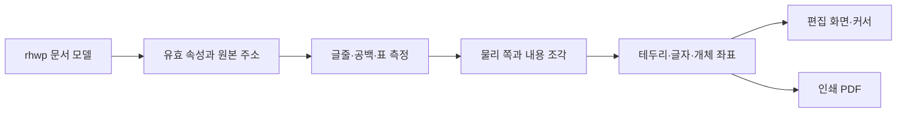

# 한컴 조판 대조 기록과 새 코어의 입력 계약

## 하나의 원본에서 세 관측을 연결

사용자가 확인한 한컴 PDF는 시험의 HWPX 원본에서 생성됐습니다. 시험 사본과 원본의 SHA-256이 같습니다. 한글에서 본 원본 화면, 한컴 PDF, 같은 원본을 연 Pwh 화면을 비교 대상으로 삼습니다. Pwh 인쇄 PDF는 Pwh 화면과의 일관성 검사에도 사용합니다.

| 자료원 | 기록할 항목 | 관측 기준 |
| --- | --- | --- |
| 저장 HWPX | 구역·문단·표·셀 주소, 용지·여백, 서식 참조, 글줄 메타데이터, 개체와 공백 | HWPUNIT, 원본 순서, 원본 SHA-256 |
| 한글 화면·애드온 | 현재 커서의 리스트·문단·문자 주소, 표시 쪽 번호, 상위 개체, 글자·문단 속성, 화면에서 확인한 조판부호 | 캡처 당시 화면과 논리 주소. PDF 물리 쪽 번호와 별도 |
| 한컴 PDF | MediaBox, 물리 쪽, 실제 글자·테두리·개체 좌표, 글꼴과 선 | 좌측 위 기준 pt, 원래 출력 크기 |
| Pwh | 논리 내용 범위, 배치 상자, 편집 화면과 인쇄 결과 | WASM 해시, 물리 쪽, 같은 원점과 단위 |

한글 화면에서는 원본 첫 쪽의 제목과 표 구성을 확인했습니다. 14쪽과 15쪽의 한글 화면에서 조판부호를 켠 대조는 별도 검증 항목입니다. 현재 r29의 수치와 쪽 승인은 한컴 PDF와 Pwh의 실제 인쇄 PDF를 비교한 기록입니다.

## 원본과 PDF에서 확인한 사례

기준 PDF의 메타데이터는 한글 2024 13.0.0.4225, Hancom PDF 1.3.0.550입니다. HWPX의 가로 방향 용지 크기는 원본 속성에서 841.88×595.28pt이고, 기준 PDF의 MediaBox는 841×595pt입니다. 비교는 용지를 확대하거나 내용을 이동하지 않고 가장자리 반올림만 처리합니다.

14쪽 위쪽 중첩 표는 원본에 어울림, 문단 기준 왼쪽, 가로 오프셋 0으로 저장돼 있습니다. 원본에는 아래와 같은 독립 값이 있습니다.

| 원본 속성 | PDF에서 관측한 결과 |
| --- | --- |
| 자식 표 폭 53,737HU, 높이 16,110HU | 테두리 중심선 사이의 폭 약 537.14pt, 높이 약 161.08pt |
| 셀 `hasMargin=0`, 저장된 셀 여백 0, 부모 표의 좌우 안 여백 510HU와 위아래 141HU | 셀 내용 기준에 부모 표의 안 여백이 관여합니다. 안 여백을 지정한 사본과 대조해 상속 적용 경계를 분리합니다. |
| 자식 표 위아래 바깥 여백 각 141HU, 다음 글줄 시작 16,392HU | 표 본체와 두 바깥 여백의 합이 다음 글줄의 저장 시작과 일치합니다. PDF의 글자 잉크 상단은 별도로 측정합니다. |
| 앞쪽에 높이 1,000HU·간격 600HU인 빈 문단, 그 뒤의 제목 문단에 표 제어 요소 포함 | 빈 문단의 저장 시작 1,600HU, 제목 문단의 저장 시작 3,200HU입니다. 제목과 표는 원본 문단을 공유하고, 한컴 출력에서는 서로 다른 쪽에 놓입니다. |
| 문단 기준 왼쪽과 오프셋 0 | 한컴의 표 왼쪽은 207.85pt입니다. 해당 원본 프레임을 쓰는 Pwh r29는 208.21pt입니다. |

15쪽 마지막 행과 16쪽 시작은 같은 상위 표에 속합니다. 코어 추적에서 15쪽에 두 줄을 배치하고 16쪽 첫 원문으로 인라인 표를 넘기는 소비 범위를 확인했습니다. 한컴 PDF에서 15쪽 행 테두리가 차지하는 높이는 58.65pt입니다. 실험에서는 저장 글줄이 새 프레임을 시작한다는 근거, 편집되지 않은 셀의 선언 높이, 부모가 전달한 본문 예산을 사용해 물리 높이를 따로 계산했습니다. 원문 소비를 그대로 두고 물리 높이를 59.6pt로 계산할 수 있었습니다. 부모 테두리와 셀 안의 세로 정렬은 이 물리 높이를 공유합니다. 병합·편집·가용 높이가 달라진 사례는 추가 검증 대상으로 기록합니다.

이 문서에서 수집한 저장 구조에는 표 82개, 셀 2,146개, 저장 글줄 3,244개, 단 관련 제어 요소 243개, 명시적인 줄바꿈 25개, 고정 폭 공백 요소 18개가 있습니다. PDF에 남는 잉크뿐 아니라 이런 원본 요소가 남기는 줄 상자·공간도 검증 대상으로 삼습니다.

## 공백과 조판부호 실험

1. 같은 문서의 시험 사본을 만들고 본문 폭·글꼴·크기·용지·출력기를 고정합니다. 변수 하나를 한글에서 바꾼 뒤 저장하고 원본 XML, 애드온 JSON, 한컴 PDF를 같은 시험 ID로 묶습니다.
2. 일반 공백과 연속 공백, 끊기지 않는 공백, 고정 폭 공백, 탭을 각각 시험합니다. 줄 끝에서 다음 글자의 위치와 줄바꿈 결과를 비교합니다.
3. 빈 문단, 수동 줄바꿈, 단·쪽 나눔, 표·그림 앵커, 각주·미주의 구조 위치를 따로 기록합니다. 글자로 보이는 쪽과 공간만 차지하는 쪽을 구분합니다.
4. 문단 앞뒤 간격, 줄간격, 셀 안 여백, 표 바깥 여백, 용지와 머리·꼬리말 여백을 하나씩 바꿉니다. 딱 들어갈 때와 1HU 또는 작은 단계만큼 부족할 때를 모두 측정합니다.
5. 그 뒤에 중첩과 병합, 반복 머리행, 가운데 정렬, 그림과 표를 조합합니다. 통과한 사례와 반례를 독립된 문서에도 재현합니다. 원본 보관 자료와 공유 가능한 합성 시험을 분리합니다.

## 조판 결정표

API Credit Bridge의 설계 검토를 반영해, 원본 근거와 계산 결과를 분리합니다. 출력 계약은 **원문 반개구간과 표시 회차 → 물리 쪽·글줄·표/셀·상자·기준선**입니다. 반복 머리행은 같은 원문 구간을 가리키되 표시 회차를 구분합니다.

| 판단 축 | 원본 또는 화면의 근거 | 새 코어의 계산과 판정 |
| --- | --- | --- |
| 입력과 환경 | 원본 해시, 저장·라이브 구분, 한글 버전, 용지, 글꼴, 배율 | 같은 입력으로 확인된 경우에 기하를 대조합니다. 글꼴 대체가 필요하면 선택과 버전을 기록합니다. |
| 주소와 제어 요소 | 구역·리스트·문단·문자 주소, 서식 참조, 중첩 컨트롤의 앵커 | UTF-16, 저장 글줄 위치, 네이티브 커서의 단위를 분리합니다. PDF 추출 순서와 원문 순서는 별도 대조합니다. |
| 글자와 글줄 | 글자 모양, 문단 모양, 저장 `textpos/vertpos/vertsize/baseline/spacing` | 현재 입력으로 글자 폭과 줄 상자를 계산합니다. 저장값을 사용하는 조건은 같은 속성의 합성 시험으로 확인합니다. |
| 공백과 빈 줄 | 일반·특수 공백, 탭 정지점, 빈 문단, 강제 줄바꿈 | 줄을 끝내는 규칙과 공간을 전진하는 규칙을 구분합니다. 빈 줄 상자는 인접 글줄로 실측한 간격과 대조합니다. |
| 가로·세로 개체 배치 | 글자처럼 취급, 어울림, 자리 차지, 글 앞뒤, 기준 용지·쪽·단·문단, 정렬과 오프셋 | 축별 기준 상자와 해당 방향의 바깥 여백을 확정합니다. 가로 원점이 바뀌어도 세로 흐름을 다시 정하지 않습니다. |
| 표와 셀 | 병합, 반복 머리행, 세로 정렬, 안·바깥 여백, 실제 내용 높이와 선언 높이 | 일반 행과 병합 행 블록의 수용 범위를 계산합니다. 반복 머리행은 배치 높이를 예약하며 원문의 소비 커서는 그대로 둡니다. |
| 쪽 경계 | 나눔 속성, 명시적 쪽·단 나눔, 저장 좌표 재시작, 현재 본문 예산 | 실제 강제 나눔과 저장 당시의 좌표 재시작을 분리합니다. 다음 쪽으로 넘기는 원문 범위와 현재 쪽 테두리 높이를 각각 기록합니다. |
| 검증과 편집 | 화면 커서, 표시 쪽 번호, PDF 물리 쪽, 수정·실행 취소 후 문서 상태 | 현재 화면과 PDF 좌표를 물리 기준으로 연결합니다. 편집으로 유효하지 않게 된 저장값은 현재 측정 결과로 대조합니다. |

현행 Pwh 파서가 읽는 HWPX 분할 이름은 `CELL`·`ROW`가 모델의 `RowBreak`, `TABLE`이 `CellBreak`입니다. 이 매핑과 실제 렌더러의 분할 조건을 별도로 기록합니다. 원본 증거로 확정되지 않은 조합은 후보 계산과 한컴 실측을 함께 남깁니다.

실험 순서는 **물리 단위·커서 대조 → 저장 줄 좌표의 재열기 의존성 → 제목과 어울림 표의 경계 → 저장 좌표 재시작과 짧은 추가 쪽 → 공백·탭·빈 줄 → 병합·반복·여백의 결합**입니다. 각 묶음은 같은 원본을 한글과 Pwh에서 화면과 PDF로 대조하고, 첫 차이가 난 원문 범위와 적용 조건을 기록합니다. 실측 없는 저장 위치를 그대로 강제하면 앞부분의 외형은 비슷해도 편집·폰트·쪽에 남는 높이 변화에서 뒤쪽 원문 범위가 어긋날 수 있습니다.

## 새 조판 코어의 경계

rhwp의 파서와 문서 모델을 속성 입력으로 사용합니다. 새 계산 경로는 원본의 구조 주소와 측정 결과를 명시적으로 전달합니다.

같은 배치 결과에서 화면·커서·인쇄 좌표를 파생합니다. 기존 코어와 새 코어를 같은 입력·같은 글꼴에서 대조하고, 검증한 범위부터 새 계산을 채택합니다. 점수는 연속 쪽 기준으로 보존하고, 내용을 숨기거나 쪽 대응을 바꾸면 통과로 보지 않습니다. 현재 공개 비교 기준은 [쪽별 검증](../RENDER-COMPARISON.md#page-acceptance), 최신 결과는 [조판 일치 검증](../LAYOUT-FIDELITY.md)에 있습니다.
